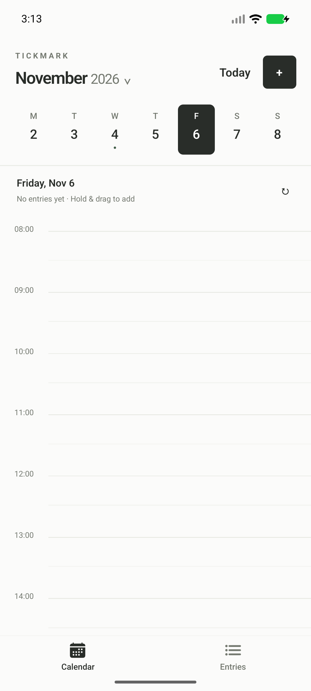
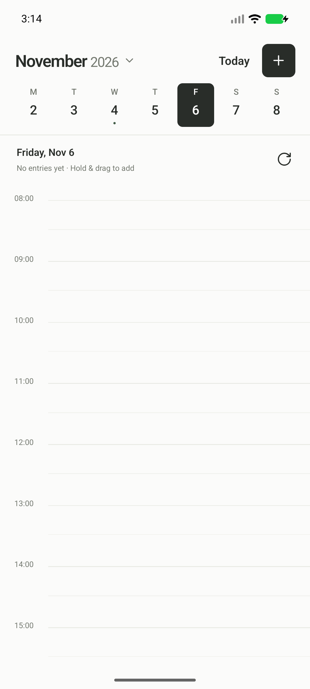
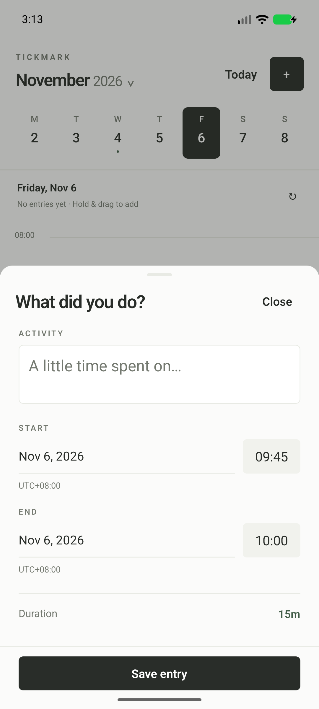
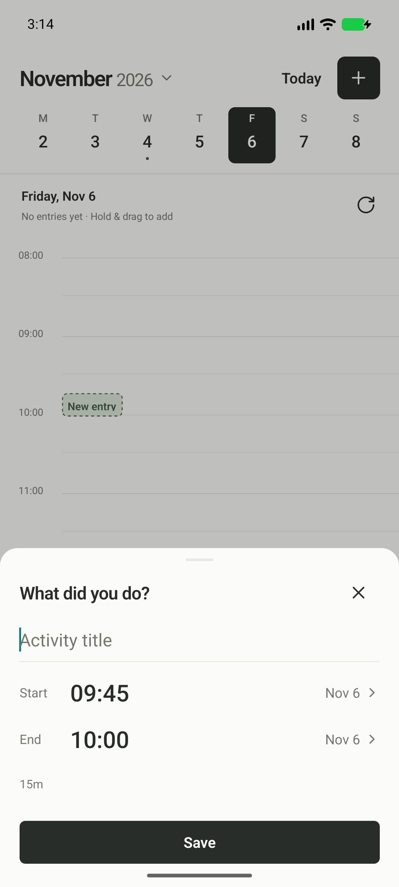

# Before and after

Captured on the same Android API 37.1 emulator, 1080×2400 at density 420 and default text size. Before is the archived 1.0 APK; after is the final refinement preview. Both screenshots select the empty November 6 date. Editor screenshots show an unsaved 09:45–10:00 draft with the keyboard dismissed. These comparison captures use the production-origin builds but perform no writes and contain no saved entry content. The isolated validation APK was restored afterward.

| Screen | Before | After |
| --- | --- | --- |
| Calendar |  |  |
| Editor |  |  |

The bottom tabs are removed, the header is shorter, and the timeline gains usable height. The default new-entry sheet is approximately 349 dp high rather than 571 dp on this emulator. Date labels no longer dominate each row; the larger time controls are separate targets. The title field grows with content rather than reserving a large empty box. Existing-entry editing also includes a secondary delete action.
