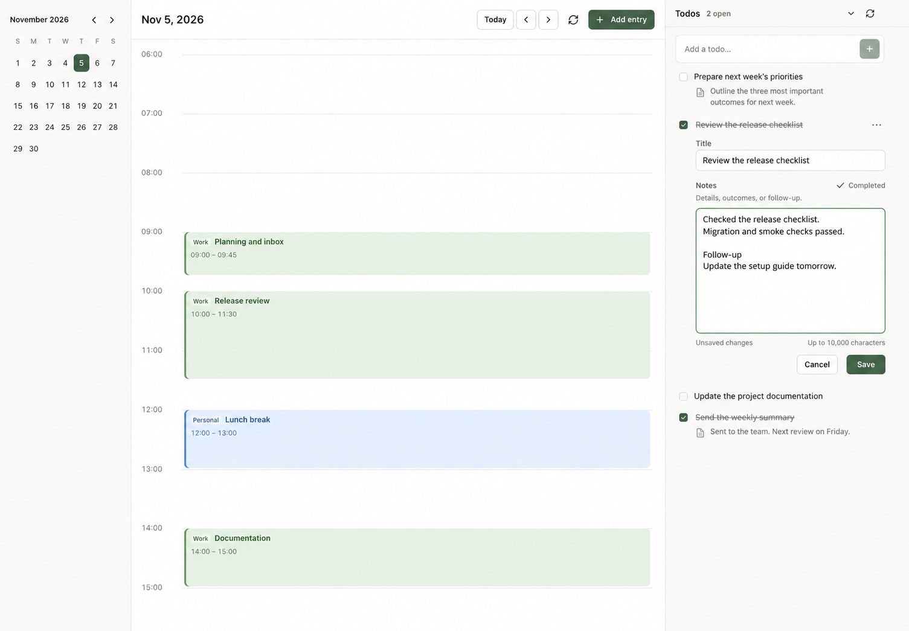
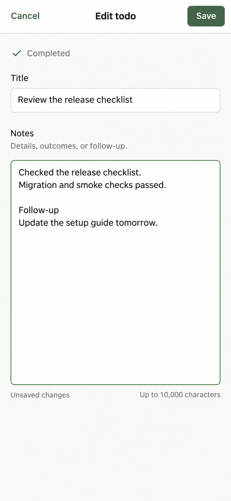

# Todo Notes design proposal

Status: visual proposal for plan 08, not an implemented or approved interface.
Created on 2026-11-05 after inspecting the UI update in commit `795359c`.
The server contract is implemented in `51af35b`.

## Current UI baseline

The current app already has one unified todo list, stable ID ordering, a compact
more-actions menu, and notifications outside document flow. This proposal builds
on those behaviors. It does not restore the old completed-task section.

The reference screenshots were captured from the current local Vite app with
synthetic API responses intercepted in an isolated browser. No production data
was changed. Desktop reference: 1440 × 1000; narrow-screen reference: 390 × 844.

- [Current desktop](current-desktop.png)
- [Current narrow-screen layout](current-mobile.png)

## Proposed screens

### Desktop: edit within the task list

Keep the calendar, navigation, sidebar width, quick-add input, and task order.
Opening a task expands Title and Notes underneath its existing row. Only one
editor is open at a time. A completed task remains checked while editing; its
row title has a strike-through, but the input and note text do not.

Notes has a multiline plain-text input with room for at least six lines. Save
and Cancel are explicit. A muted dirty-state label appears only after a change;
the length hint states the 10,000-character limit. In implementation, provide an
actual scalar count near the limit and an associated error when exceeded.

Tasks with notes show a small note icon and a maximum two-line preview. The
preview and title can open the editor; the more menu retains an explicit edit
entry for discoverability and keyboard access. Editing a preview focuses Notes;
editing from the menu can focus Title. The preview never uses strike-through.
Tasks with empty notes do not gain an empty preview row.

### Narrow screens: give writing its own space

Below the existing 759px breakpoint, opening the same editor presents a
full-height sheet over the calendar. Cancel and Save stay in a persistent top
toolbar; the form scrolls inside the remaining visible viewport. A status label
shows that the task is already completed. There is no status mutation implied by
saving a note.

This is a deliberate adjustment to the original plan: the current bottom Todos
panel is only 38dvh tall, which leaves too little room for a long note and the
software keyboard. Closing the sheet returns to the same task and list position.
The existing calendar and list layout remains the resting state.

The sheet must manage focus as a dialog, make background controls inert, restore
focus to its trigger, and protect a dirty draft on Cancel, Escape, or navigation.
Use the visible viewport and safe-area insets so Save remains reachable with the
keyboard open. The image shows the keyboard-closed layout; keyboard behavior
requires browser/device verification during implementation.

## Completion and draft flow

1. Checking a task saves COMPLETED immediately and preserves its position.
2. After confirmed success, the existing floating notice offers Add note or
   Edit note for that task. No editor opens automatically and no note is required.
3. The action opens the editor and focuses Notes. The task's own edit entry
   remains available after the transient notice closes.
4. Save sends only changed title/description fields. It never resends an old
   status value. Success closes the editor and updates the preview.
5. Cancel discards only after confirmation if dirty. Failed or uncertain writes
   retain the draft; a successful completion is not undone by a failed note save.

If the floating-notice component is extended with an action, preserve its
existing pause-on-hover/focus behavior. The permanent task entry is the fallback
for a dismissed notice. If a calendar entry editor is open, opening Todo Notes
must preserve that draft; the narrow-screen sheet overlays it without unmounting
it. On desktop the todo region and entry region retain independent scrolling.

## Visual and implementation boundaries

- Reuse existing tokens, system fonts, small radii, and muted green controls.
- Keep the current 368px desktop / 320px intermediate sidebar widths.
- Use plain text, preserve line breaks, and wrap long words. No rich-text toolbar,
  comment thread, attachments, author avatars, or fabricated completion timestamp.
- Keep quick creation title-only; users can add Notes afterward.
- Preserve the partial-write, offline, and uncertain-save behavior in plan 08.
- The images are AI-generated visual references, not pixel-exact browser
  renders. Existing CSS tokens and accessibility requirements take precedence
  over small image-generation differences in spacing or glyphs.

## Generation

Both proposals were generated with the built-in `image_gen` tool, using the
current screenshots as references. The mobile prompt also used the desktop
proposal to keep the fields consistent. Prompts are preserved in
[desktop-prompt.txt](desktop-prompt.txt) and [mobile-prompt.txt](mobile-prompt.txt).
The source screenshots and final selected images are stored in this directory.
No application source files were changed for this proposal.
