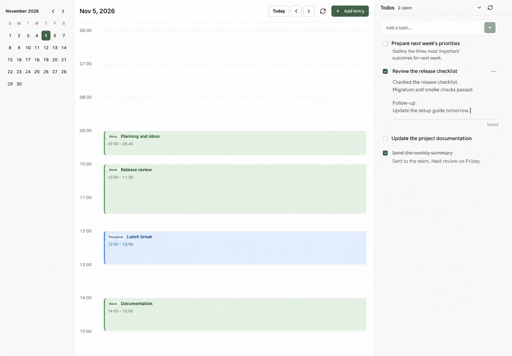
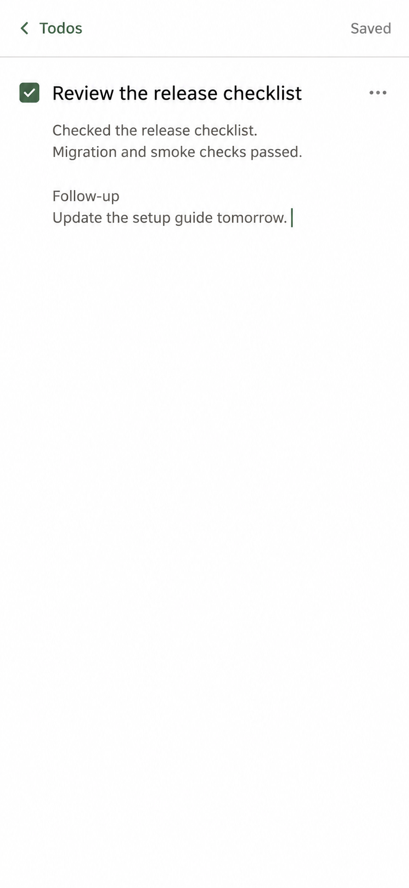

# Todo Notes design proposal, revision 2

Status: revised visual proposal for plan 08; not implemented. Revision 1 was
rejected because it duplicated the title, added unnecessary note icons, and
required Save/Cancel. Revision 2 follows the user's direct-edit and autosave
feedback. The server contract is implemented in `51af35b`.

## Current UI baseline

The existing UI update (`795359c`) already provides one unified todo list,
stable ordering, a more-actions menu, and floating notifications. Preserve those
behaviors, the existing calendar, and the 368px desktop / 320px intermediate
sidebar widths. Source screenshots use synthetic data intercepted in an isolated
browser; no production data was changed.

- [Current desktop](current-desktop.png), captured at 1440 × 1000.
- [Current narrow-screen layout](current-mobile.png), captured at 390 × 844.

## Direct editing

The title appears once and is itself editable. Notes appear directly below it,
aligned with the title, in smaller, softer text. There are no document icons,
duplicated titles, visible field labels, form cards, or Save/Cancel buttons.
Use real inputs/textareas styled as text, with accessible names and visible
keyboard focus. Avoid contenteditable and its extra formatting behavior.

Clicking the title edits that same title in place. Clicking the notes expands
the preview into a borderless textarea, keeping the caret in the same content.
Nonactive notes show at most two lines; active notes grow with the content and
provide some trailing writing room. Empty notes occupy no row at rest; focusing
a task reveals an understated “Add notes…” placeholder below its title. The
more menu retains an edit action and can focus this otherwise empty field.

Use existing compact type as the starting point: approximately 13px medium dark
titles and 12px muted notes on desktop. Maintain adequate contrast. Do not shrink
editable text below 16px on touch devices; use weight and color to maintain the
hierarchy there. Only resting completed titles use strike-through; active title
editing removes it for readability. Notes never use strike-through.

A small per-task save status occupies reserved space while editing: “Waiting to
save…”, “Saving…”, “Saved”, or “Could not save · Retry”. Saved is shown only when
all current valid edits have been acknowledged. Routine saves never show a toast,
close the editor, move the caret, disable typing, or change the task's position.
The images show the acknowledged state with the editor still focused.

## Narrow-screen editing

Below 759px, use a full-height editing sheet because the resting 38dvh todo
panel is too short for long notes and a software keyboard. Its toolbar contains
“‹ Todos” (back navigation) and the save status, with no Save/Cancel controls.
The task title appears exactly once in the content, followed by editable notes.
Use a real wrapping textarea for long titles, not a duplicated heading and input.

Returning to Todos flushes pending edits and restores the task's position and
focus. The sheet manages dialog focus and background inertness, respects the
visible viewport and safe areas, and preserves any underlying calendar entry
draft. Keyboard-open behavior remains an implementation verification item.
Back and Escape mean finish editing; they do not discard already autosaved text.

## Autosave contract

- Update the local visible draft immediately on every input. For each task,
  schedule the first write five seconds after its first dirty input. Later input
  updates the pending snapshot without resetting the deadline.
- During continuous typing, start at most one normal autosave per five seconds
  per task. Preserve a trailing write: the last edits must save even when typing
  stops. This is throttling, not a five-second inactivity debounce.
- Leaving the whole task editor, switching tasks, collapsing it, or returning
  from the mobile sheet flushes valid pending changes early. These explicit
  finish-editing flushes are exceptions to the normal five-second interval.
  Moving focus between Title and Notes inside the same task does not flush.
- Serialize writes per task; never overlap PATCH requests or cancel a write
  just to send newer text. Keep only the latest pending draft. An old response
  updates the acknowledged snapshot, never overwrites newer input, and never
  marks newer unsent edits Saved. A slow response may delay the next write.
- Send only fields changed from the last acknowledged value. Never include an
  old status in a description PATCH. Completion/reopening remains immediate,
  shares the per-task write queue, and preserves notes. Autosave does not close
  the editor. Do not autosave the quick-add field, which would create partial
  or duplicate tasks.
- Do not submit a temporarily empty or oversized title, an oversized note, or an
  active IME composition. Show the field error and retain the draft. Other valid
  changed fields can save independently, but the task must not say Saved while
  an invalid dirty field remains. Composition end reschedules any due write.
- Ordinary save errors keep the draft and expose Retry. Stop periodic retry on
  failures; reconnecting first reloads server state. A timeout or ambiguous
  response requires comparison with the sent snapshot before another write.
  A 404 preserves copyable text and never recreates the todo automatically.
- Persist unacknowledged drafts locally by task ID, together with their last
  acknowledged base, before scheduling a remote write. After reload, compare
  with server data before offering recovery; never silently replay a stale
  local draft over another device's edits. If local storage is unavailable,
  keep the in-memory draft and explicitly report the limitation.
- Internal navigation waits for a flush when needed. Refresh/tab close uses
  dirty-state protection and local recovery; an asynchronous unload request
  cannot guarantee server persistence. Background list refreshes must not
  replace active drafts. Keep last-write-wins semantics explicit; updated_at
  is not a version token.
- Confirmed deletion cancels pending timers and clears the matching local draft;
  queued responses must not restore a deleted row. Merely blurring onto Delete
  must not cause a later autosave to recreate or overwrite it.

## Completion flow

Checking a task preserves its position and saves completion without requiring
notes or opening an editor. A small Add note/Edit note action can remain in the
existing completion notice; the permanent task edit entry works after that notice
closes. Notes autosave after entry. A note-save failure does not undo completion.

## Artifacts and generation

Revision 2 uses the built-in `image_gen` tool to edit the previous proposal.
Prompts: [desktop](desktop-v2-prompt.txt), [mobile](mobile-v2-prompt.txt).
Images are visual references, not pixel-exact renders; actual CSS, focus behavior,
contrast, and responsive wrapping govern implementation. No application source
files were changed for this proposal.

The original `desktop-notes-proposal.png`, `mobile-notes-proposal.png`, and their
prompts remain as superseded history; do not implement their form or save flow.

## Latest interaction refinement

The implemented refinement supersedes the earlier typography and save-status treatment: desktop titles use the original 12px/400 styling in both modes; routine save labels and the editor rail are removed. Empty notes show a single-line `Add notes...` placeholder only while editing, and grow/shrink with content without reserved height. Browsing still shows at most two lines. Mobile editing uses 16px text. Exceptional save and recovery feedback remains visible.
